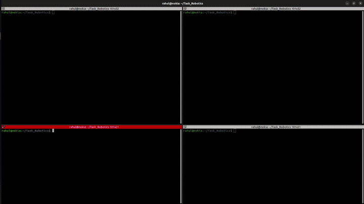
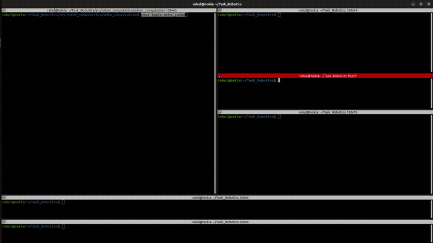
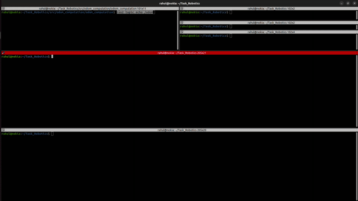

# ROS 2 Robotics Assignment — Gahan AI

This repository contains the complete implementation for the ROS 2 Humble technical assessment, covering two main tasks and an optional bonus task.

---

## 📋 Overview of Tasks

1. **Task 1: Differential Drive Robot Simulation & Nav2 Integration (`diff_drive_robot`)**
   - 2-wheel differential drive robot model in URDF/Xacro with LiDAR mounted on top and internal IMU.
   - Custom 6m x 6m Gazebo world with walls and various obstacles (boxes, cylinders).
   - Real-time SLAM mapping using SLAM Toolbox.
   - Nav2 autonomous goal navigation with dynamic obstacle avoidance using costmaps and DWB local planner.
   - Localization on pre-saved maps using AMCL and Map Server.

2. **Task 2: Odometry Computation from Encoder Ticks (`odom_computation`)**
   - Python ROS 2 node subscribing to `/left_wheel_ticks` and `/right_wheel_ticks` (`std_msgs/msg/Int32`).
   - Differential drive midpoint kinematic model computing robot pose $(x, y, \theta)$ and linear/angular velocities.
   - Yaw converted to quaternion orientation.
   - Publishes continuous `/odom` messages (`nav_msgs/msg/Odometry`) at 10 Hz.

3. **Optional Bonus Task: Simulated IMU Publisher**
   - Node `imu_publisher.py` publishing realistic synthetic 6-DOF IMU data (`sensor_msgs/msg/Imu`) to `/imu/data` at 20 Hz.

---

## 🗂️ Repository Structure

```text
Task_Robotics/
├── src/
│   ├── diff_drive_robot/          # Task 1: Simulation & Navigation Package
│   │   ├── config/
│   │   │   ├── nav2_params.yaml   # Nav2 costmap, planner & controller params
│   │   │   └── slam_params.yaml   # Fast real-time SLAM Toolbox config
│   │   ├── launch/
│   │   │   ├── gazebo.launch.py   # Spawns robot in custom Gazebo world
│   │   │   ├── slam.launch.py     # Pure SLAM mapping with RViz
│   │   │   ├── navigation.launch.py # Online SLAM + Nav2 navigation
│   │   │   └── nav_saved_map.launch.py # Saved map AMCL + Nav2 navigation
│   │   ├── maps/
│   │   │   ├── my_map.pgm         # Saved map occupancy grid
│   │   │   └── my_map.yaml        # Map metadata
│   │   ├── urdf/
│   │   │   └── robot.urdf.xacro   # Robot URDF with Gazebo plugins (diff-drive, ray, imu)
│   │   └── worlds/
│   │       └── obstacles.world    # Gazebo custom walled world with obstacles
│   │
│   └── odom_computation/          # Task 2 & Bonus Package
│       ├── launch/
│       │   └── odom.launch.py     # Launch file for odom + imu nodes
│       └── odom_computation/
│           ├── odom_node.py       # Differential drive odometry computation node
│           └── imu_publisher.py   # Simulated IMU publisher node
│
├── wheel_tick_pub.py              # Provided test node for simulated wheel ticks
├── task2.webm                     # Task 2 video demonstration
├── imu_bonus_task.webm            # Bonus Task video demonstration
├── navigation_task1.webm          # Task 1 video demonstration
└── README.md
```

---

## ⚙️ Prerequisites & Environment

- **OS:** Ubuntu 22.04 LTS
- **ROS 2:** Humble Hawksbill
- **Gazebo:** Gazebo 11 (Classic)
- **Required Packages:**
  ```bash
  sudo apt-get update
  sudo apt-get install -y \
    ros-humble-gazebo-ros-pkgs \
    ros-humble-navigation2 \
    ros-humble-nav2-bringup \
    ros-humble-slam-toolbox \
    ros-humble-robot-state-publisher \
    ros-humble-xacro \
    ros-humble-teleop-twist-keyboard
  ```

---

## 🔨 Build Instructions

Clone the repository and build the workspace:

```bash
cd ~/Task_Robotics
source /opt/ros/humble/setup.bash
colcon build --symlink-install
source install/setup.bash
```

---

## 🚀 How to Run & Test

### 🔹 Task 2: Odometry from Wheel Encoder Ticks

1. **Terminal 1: Start the simulated tick publisher**
   ```bash
   python3 wheel_tick_pub.py
   ```

2. **Terminal 2: Launch the odometry computation node**
   ```bash
   source /opt/ros/humble/setup.bash
   source install/setup.bash
   ros2 run odom_computation odom_node
   ```

3. **Terminal 3: Verify the `/odom` output**
   ```bash
   source /opt/ros/humble/setup.bash
   ros2 topic echo /odom
   ```
   *Expected: Continuous forward position update ($x$ increases, $y \approx 0, \theta \approx 0$), valid quaternion orientation, linear velocity $v_x \approx 0.2\text{ m/s}$.*

---

### 🔹 Bonus Task: IMU Publisher Node

1. **Launch the IMU node:**
   ```bash
   source /opt/ros/humble/setup.bash
   source install/setup.bash
   ros2 run odom_computation imu_publisher
   ```

2. **Verify the `/imu/data` topic:**
   ```bash
   ros2 topic echo /imu/data --once
   ```

*(Alternatively, launch both Task 2 and Bonus together using `ros2 launch odom_computation odom.launch.py`)*

---

### 🔹 Task 1: Robot Simulation, Gazebo World & Nav2 Navigation

#### 1. Launch Gazebo Simulation
Spawns the robot in the custom obstacle world with LiDAR, IMU, and differential drive plugins:
```bash
source /opt/ros/humble/setup.bash
source install/setup.bash
ros2 launch diff_drive_robot gazebo.launch.py
```

#### 2. Option A: Autonomous Navigation on Pre-saved Map (Recommended)
Loads the pre-saved map (`my_map.yaml`) with AMCL localization and Nav2 stack:
```bash
# In a new terminal:
source /opt/ros/humble/setup.bash
source install/setup.bash
ros2 launch diff_drive_robot nav_saved_map.launch.py
```
- In the opened **RViz** window, click the **"Nav2 Goal"** button (or press `G`) and click any target position on the map.
- The robot autonomously calculates a collision-free global path, avoids obstacles, and drives to the target.

#### 3. Option B: SLAM Mapping Mode
To generate and save a fresh map:
```bash
# In a new terminal:
source /opt/ros/humble/setup.bash
source install/setup.bash
ros2 launch diff_drive_robot slam.launch.py
```
Drive the robot using teleop in another terminal:
```bash
ros2 run teleop_twist_keyboard teleop_twist_keyboard
```
Save the map once the environment is scanned:
```bash
ros2 run nav2_map_server map_saver_cli -f ~/Task_Robotics/src/diff_drive_robot/maps/my_map
```

---

## 🎥 Demonstrations

📁 **Google Drive Link (HD Videos):** [Watch Demo Videos on Google Drive](https://drive.google.com/drive/folders/1Z9CEVX5BRYtHDLafgk9wvDsxNBZ1nd7R?usp=sharing)

### 1. Task 1: Autonomous Nav2 Navigation & Obstacle Avoidance


### 2. Task 2: Differential Drive Odometry from Wheel Encoder Ticks


### 3. Bonus Task: Synthetic IMU Publisher Node


---

## 👤 Author
- **Name:** Rahul
- **Email:** rahulrajak5629@gmail.com
